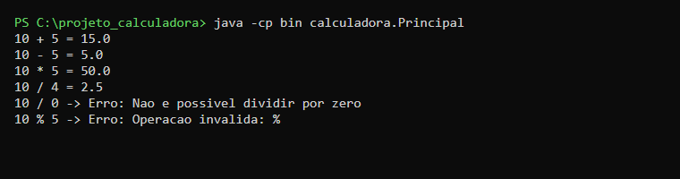
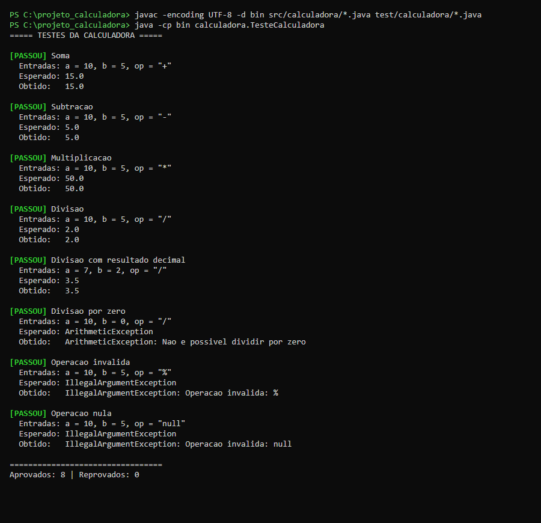
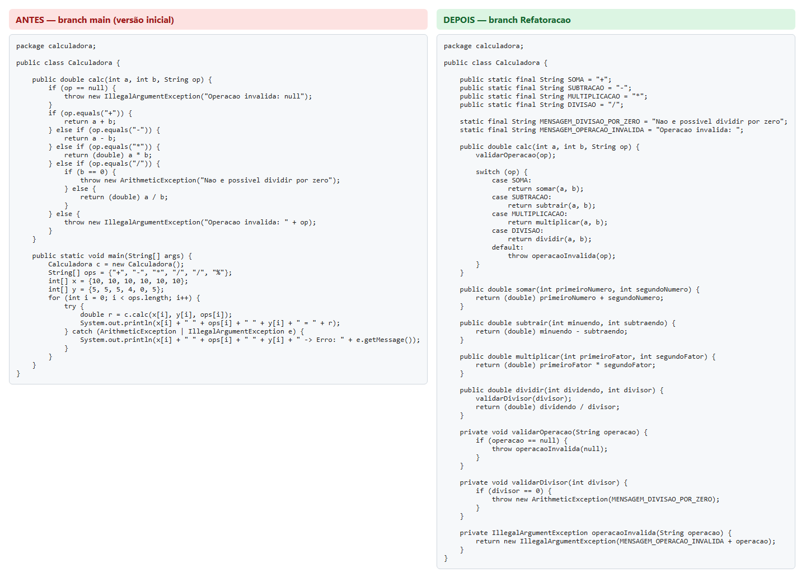
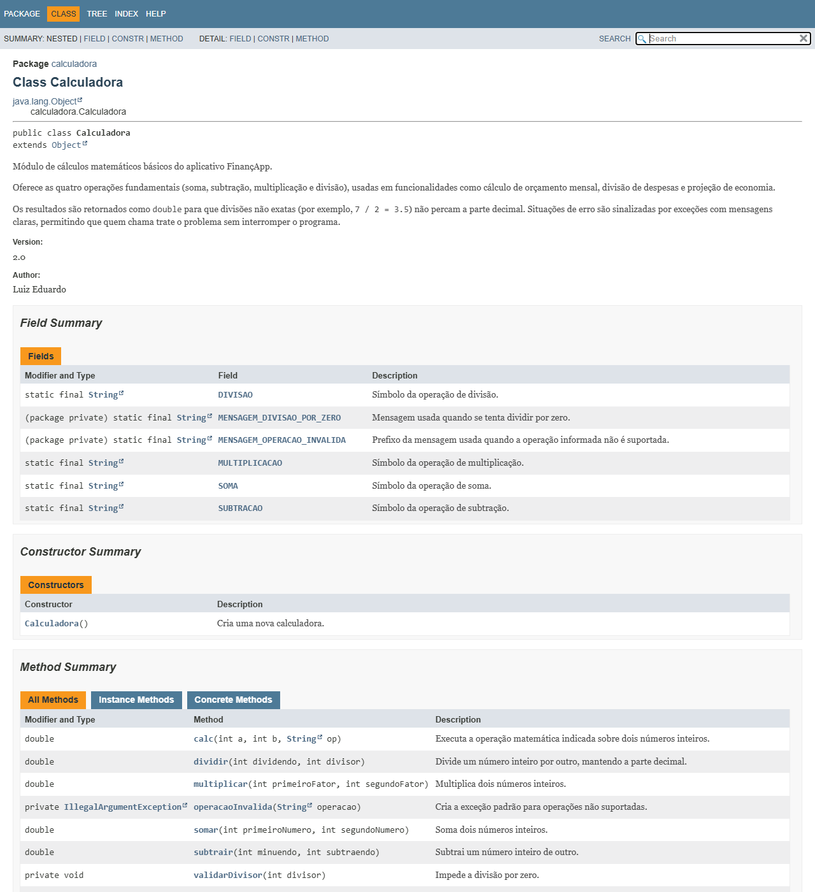

# Projeto Calculadora — FinançApp

> Projeto acadêmico desenvolvido com foco em Qualidade de Software, Testes, Refatoração, Documentação e Versionamento.

---

## 1. Identificação do Projeto

**Projeto:** Projeto Calculadora  
**Aluno:** Luiz Eduardo  
**RA:** 250695  
**Curso:** Análise e Desenvolvimento de Sistemas  
**Disciplina:** UI/UX  
**Professor:** Daniel Ohata  
**Semestre:** 2026.2  

---

# 2. Visão Geral

O projeto consiste no desenvolvimento de um módulo de cálculos matemáticos básicos em Java para a startup fictícia **FinançApp**.

O módulo foi desenvolvido com o objetivo de ser utilizado futuramente em funcionalidades de controle financeiro, como:

- orçamento mensal;
- divisão de despesas;
- projeções financeiras;
- cálculos auxiliares.

Além do funcionamento correto das operações, o projeto aplica práticas de qualidade de software relacionadas a:

- testes;
- tratamento de erros;
- refatoração;
- documentação;
- versionamento;
- manutenção de código.

---

# 3. Problema

Durante o desenvolvimento da aplicação FinançApp, foi identificada a necessidade de criar um módulo matemático reutilizável.

Entretanto, a equipe definiu que o módulo não deveria apenas funcionar corretamente, mas também apresentar:

- código legível;
- testes automatizados;
- tratamento de falhas;
- documentação técnica;
- controle de versões;
- facilidade de manutenção.

O desafio consiste, portanto, em desenvolver uma solução funcional e ao mesmo tempo aplicar boas práticas de Engenharia de Software.

---

# 4. Objetivo

## 4.1 Objetivo Geral

Desenvolver uma calculadora em Java aplicando práticas de qualidade, testes, documentação, refatoração e versionamento.

## 4.2 Objetivos Técnicos

- implementar operações matemáticas básicas;
- tratar entradas inválidas;
- impedir divisão por zero;
- desenvolver testes automatizados;
- refatorar o código sem alterar seu comportamento;
- documentar classes e métodos com JavaDoc;
- gerar documentação HTML;
- utilizar Git e GitHub;
- organizar commits e branches;
- manter documentação técnica no README.

---

# 5. Escopo Funcional

A aplicação oferece as seguintes operações:

| ID | Funcionalidade | Descrição | Status |
|---|---|---|---|
| RF01 | Soma | Soma dois números inteiros | ✅ |
| RF02 | Subtração | Subtrai dois números inteiros | ✅ |
| RF03 | Multiplicação | Multiplica dois números inteiros | ✅ |
| RF04 | Divisão | Divide dois números inteiros | ✅ |
| RF05 | Validação de divisão | Impede divisão por zero | ✅ |
| RF06 | Operação inválida | Trata operadores não suportados | ✅ |

---

# 6. Requisitos Não Funcionais

| ID | Categoria | Requisito | Como foi atendido |
|---|---|---|---|
| RNF01 | Qualidade | O código deve possuir organização e legibilidade | Métodos pequenos, nomes descritivos e constantes para operações e mensagens |
| RNF02 | Testabilidade | As operações devem possuir testes automatizados | Classe `TesteCalculadora` com 8 testes |
| RNF03 | Manutenção | O código deve permitir refatoração sem alteração funcional | Testes executados antes e depois da refatoração, com o mesmo resultado |
| RNF04 | Documentação | Classes e métodos devem possuir JavaDoc | JavaDoc completo e HTML gerado em `docs/` |
| RNF05 | Versionamento | O projeto deve utilizar Git e GitHub | Branches `main` e `Refatoracao` com commits organizados |
| RNF06 | Confiabilidade | Erros não devem interromper inesperadamente a execução | Exceções com mensagens claras, tratadas pela classe `Principal` |

---

# 7. Tecnologias Utilizadas

| Tecnologia | Versão | Utilização |
|---|---|---|
| Java | 21 (código compatível com Java 8+) | Desenvolvimento |
| JDK | Eclipse Temurin 21.0.13 | Compilação |
| Testes | Classe própria `TesteCalculadora` (sem framework) | Testes unitários |
| Git | 2.56.0 | Controle de versão |
| GitHub | — | Repositório remoto |
| JavaDoc | — | Documentação |
| IDE | Não obrigatória | Compilação e execução via linha de comando |

> Os testes foram implementados em Java puro, sem dependências externas, para que o projeto compile e execute apenas com o JDK. Cada teste exibe as entradas, o resultado esperado e o resultado obtido.

---

# 8. Estrutura do Projeto

```text
projeto_calculadora/
│
├── src/
│   └── calculadora/
│       ├── Calculadora.java        # operações da calculadora
│       ├── Principal.java          # demonstração de uso (main)
│       └── package-info.java       # documentação do pacote
│
├── test/
│   └── calculadora/
│       └── TesteCalculadora.java   # testes unitários
│
├── docs/
│   └── index.html                  # documentação JavaDoc gerada
│
├── images/
│   ├── testes/
│   ├── javadoc/
│   └── refatoracao/
│
├── README.md
└── .gitignore
```

---

# 9. Operações Implementadas

O método principal é:

```java
public double calc(int a, int b, String op)
```

Ele recebe dois números inteiros e o símbolo da operação, e retorna o resultado como `double`, para que divisões não exatas (como `7 / 2`) preservem a parte decimal.

| Operação | Símbolo | Exemplo | Resultado |
|---|---|---|---|
| Soma | `+` | `calc(10, 5, "+")` | `15.0` |
| Subtração | `-` | `calc(10, 5, "-")` | `5.0` |
| Multiplicação | `*` | `calc(10, 5, "*")` | `50.0` |
| Divisão | `/` | `calc(7, 2, "/")` | `3.5` |

---

# 10. Tratamento de Erros

| Situação | Exemplo | Comportamento |
|---|---|---|
| Divisão por zero | `calc(10, 0, "/")` | Lança `ArithmeticException`: "Nao e possivel dividir por zero" |
| Operação inválida | `calc(10, 5, "%")` | Lança `IllegalArgumentException`: "Operacao invalida: %" |
| Operação nula | `calc(10, 5, null)` | Lança `IllegalArgumentException`: "Operacao invalida: null" |

A classe `Principal` captura essas exceções e exibe a mensagem ao usuário, de modo que um erro **não interrompe a execução do programa**:



---

# 11. Testes

A classe `TesteCalculadora` executa os seguintes testes:

| Teste | Entradas | Resultado esperado |
|---|---|---|
| Soma | `10, 5, "+"` | `15.0` |
| Subtração | `10, 5, "-"` | `5.0` |
| Multiplicação | `10, 5, "*"` | `50.0` |
| Divisão | `10, 5, "/"` | `2.0` |
| Divisão com resultado decimal | `7, 2, "/"` | `3.5` |
| Divisão por zero | `10, 0, "/"` | `ArithmeticException` |
| Operação inválida | `10, 5, "%"` | `IllegalArgumentException` |
| Operação nula | `10, 5, null` | `IllegalArgumentException` |

Cada teste exibe as **entradas utilizadas**, o **resultado esperado** e o **resultado obtido**. Ao final, é exibido um resumo; se algum teste falhar, o programa termina com código de saída 1.

## 11.1 Evidência de Execução dos Testes



**Resultado:** 8 aprovados, 0 reprovados, antes e depois da refatoração.

---

# 12. Refatoração

A refatoração foi realizada na branch `Refatoracao`. A versão inicial concentrava toda a lógica em um único método com uma cadeia de `if/else`, além de misturar a demonstração (`main`) com a lógica de cálculo.

| Técnica | Aplicação |
|---|---|
| Extração de métodos | Cada operação ganhou seu próprio método (`somar`, `subtrair`, `multiplicar`, `dividir`); validações extraídas para `validarOperacao` e `validarDivisor` |
| Simplificação de condicionais | Cadeia de `if/else` substituída por `switch` sobre constantes (`SOMA`, `SUBTRACAO`, `MULTIPLICACAO`, `DIVISAO`) |
| Melhoria de nomes | Variáveis `c`, `x`, `y` e `r` substituídas por `calculadora`, `dividendo`, `divisor`, `resultado` etc. |
| Organização lógica | Mensagens de erro centralizadas em constantes; demonstração movida para a classe `Principal`; testes movidos para a pasta `test/` |

Após a refatoração, todos os testes foram executados novamente e o comportamento do sistema permaneceu o mesmo.

## 12.1 Antes e Depois



---

# 13. Documentação JavaDoc

Classes, construtores, métodos, atributos, parâmetros, retornos e exceções estão documentados com JavaDoc, utilizando as anotações `@author`, `@version`, `@param`, `@return` e `@throws`. O código também possui comentários técnicos explicando decisões de implementação.

A documentação HTML gerada está em [`docs/index.html`](docs/index.html).

## 13.1 Evidências da Documentação

Página inicial do pacote:


Página da classe `Calculadora`:



---

# 14. Como Executar

Na pasta `projeto_calculadora`, compile o projeto:

```bash
javac -encoding UTF-8 -d bin src/calculadora/*.java test/calculadora/*.java
```

Execute os testes:

```bash
java -cp bin calculadora.TesteCalculadora
```

Execute a demonstração:

```bash
java -cp bin calculadora.Principal
```

Gere novamente a documentação JavaDoc (no Linux/macOS, use `src:test` no lugar de `src;test`):

```bash
javadoc -private -author -version -encoding UTF-8 -docencoding UTF-8 -charset UTF-8 -d docs -sourcepath "src;test" calculadora
```

---

# 15. Versionamento

| Branch | Conteúdo |
|---|---|
| `main` | Branch principal: versão inicial e versão final integrada |
| `Refatoracao` | Refatoração, documentação JavaDoc, reorganização do projeto e README |

Fluxo de trabalho:

1. A versão inicial (implementação e testes) foi desenvolvida na `main`;
2. A branch `Refatoracao` foi criada a partir dela para refatorar, documentar e reorganizar o projeto;
3. Após cada etapa, os testes foram executados novamente;
4. A branch `Refatoracao` foi integrada à `main` por meio de merge.

Cada commit representa uma etapa da atividade e pode ser consultado no [histórico do repositório](https://github.com/luizeflss/ac2-uiux-projeto-calculadora/commits/main).

---

# 16. Repositório

https://github.com/luizeflss/ac2-uiux-projeto-calculadora

---

# 17. Autor

**Luiz Eduardo**
