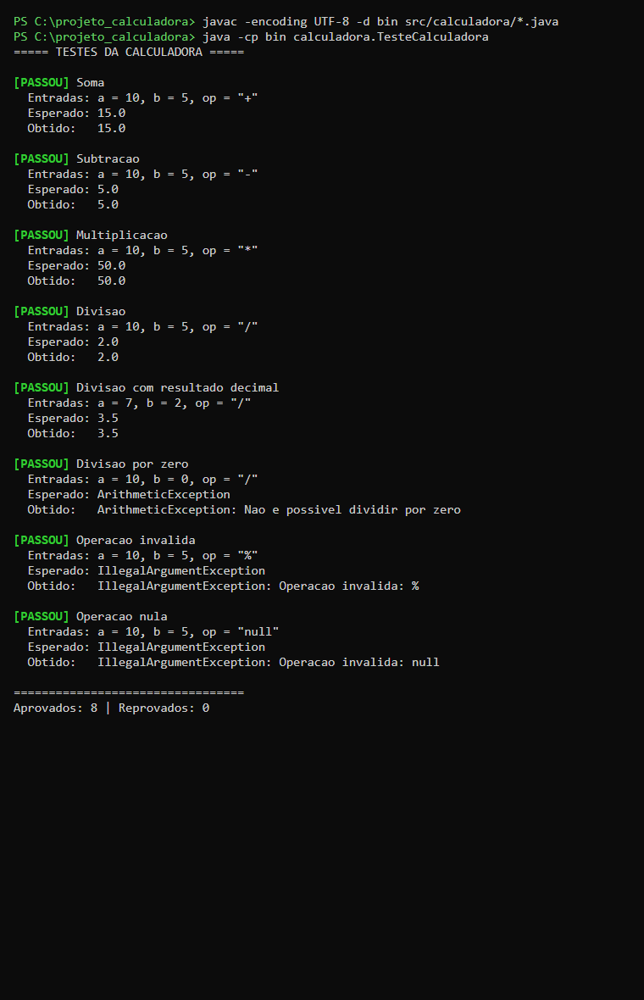
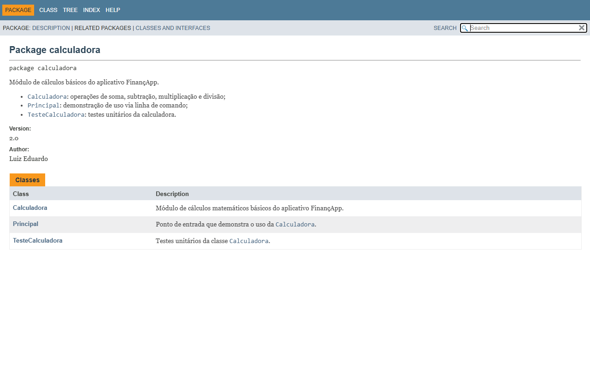

# Projeto Calculadora — FinançApp

## Descrição do projeto

Módulo de cálculos matemáticos básicos desenvolvido em Java para a startup fictícia **FinançApp**, que está criando um aplicativo mobile de controle de finanças pessoais. A calculadora será reutilizada em funcionalidades como cálculo de orçamento mensal, divisão de despesas e projeção de economia.

Além da implementação, o projeto aplica práticas de qualidade de software: testes unitários, tratamento de erros, refatoração, documentação JavaDoc e versionamento com Git.

## Objetivo da atividade

Desenvolver, de forma individual, a capacidade prática de construir, validar, manter e documentar software, aplicando:

- Testes funcionais e unitários;
- Tratamento de erros;
- Refatoração de código;
- Documentação técnica (comentários e JavaDoc);
- Versionamento de software (Git e GitHub).

## Tecnologias utilizadas

| Tecnologia | Uso |
|---|---|
| Java (JDK 21, código compatível com Java 8+) | Linguagem do projeto |
| `javac` / `java` | Compilação e execução |
| JavaDoc | Geração da documentação HTML em `docs/` |
| Git | Controle de versão (branches `main` e `Refatoracao`) |
| GitHub | Repositório remoto |

## Estrutura do projeto

```text
projeto_calculadora/
├── src/
│   └── calculadora/
│       ├── Calculadora.java       # Classe com as operações
│       ├── Principal.java         # Demonstração de uso (main)
│       ├── TesteCalculadora.java  # Testes unitários
│       └── package-info.java      # Documentação do pacote
├── docs/                          # Documentação JavaDoc gerada (abrir index.html)
├── imagens/                       # Prints usados neste README
└── README.md
```

## Explicação das operações

O método principal é `calc(int a, int b, String op)`, que recebe dois inteiros e o símbolo da operação e retorna o resultado como `double` (para que divisões como `7 / 2` resultem em `3.5`).

| Operação | Símbolo | Exemplo | Resultado |
|---|---|---|---|
| Soma | `+` | `calc(10, 5, "+")` | `15.0` |
| Subtração | `-` | `calc(10, 5, "-")` | `5.0` |
| Multiplicação | `*` | `calc(10, 5, "*")` | `50.0` |
| Divisão | `/` | `calc(7, 2, "/")` | `3.5` |

### Tratamento de erros

| Situação | Exemplo | Comportamento |
|---|---|---|
| Divisão por zero | `calc(10, 0, "/")` | Lança `ArithmeticException` com a mensagem "Nao e possivel dividir por zero" |
| Operação inválida | `calc(10, 5, "%")` | Lança `IllegalArgumentException` com a mensagem "Operacao invalida: %" |
| Operação nula | `calc(10, 5, null)` | Lança `IllegalArgumentException` com a mensagem "Operacao invalida: null" |

A classe `Principal` captura essas exceções e exibe a mensagem ao usuário, de modo que um erro em uma operação **não interrompe a execução do programa**:


## Como executar

Na pasta `projeto_calculadora`:

```bash
javac -encoding UTF-8 -d bin src/calculadora/*.java
```

```bash
java -cp bin calculadora.TesteCalculadora
```

```bash
java -cp bin calculadora.Principal
```

Para gerar novamente a documentação JavaDoc:

```bash
javadoc -private -author -version -encoding UTF-8 -docencoding UTF-8 -charset UTF-8 -d docs -sourcepath src calculadora
```

## Testes

A classe `TesteCalculadora` executa 8 testes cobrindo soma, subtração, multiplicação, divisão (exata e com resultado decimal), divisão por zero e operações inválidas (símbolo desconhecido e `null`). Cada teste exibe as **entradas utilizadas**, o **resultado esperado** e o **resultado obtido**. Se algum teste falhar, o programa termina com código de saída 1.

### Print da execução dos testes



Os testes foram executados antes e depois da refatoração, com o mesmo resultado: **8 aprovados, 0 reprovados**.

## Refatoração

A refatoração foi feita na branch `Refatoracao`. A versão inicial (branch `main`, commits iniciais) usava uma cadeia de `if/else` dentro de um único método. Após a refatoração:

- **Extração de métodos:** cada operação ganhou seu próprio método (`somar`, `subtrair`, `multiplicar`, `dividir`), e as validações foram extraídas para `validarOperacao` e `validarDivisor`;
- **Simplificação das condicionais:** a cadeia de `if/else` foi substituída por um `switch` sobre constantes (`SOMA`, `SUBTRACAO`, `MULTIPLICACAO`, `DIVISAO`);
- **Melhoria nos nomes:** variáveis como `c`, `x`, `y` e `r` deram lugar a nomes descritivos (`calculadora`, `dividendo`, `divisor`, `resultado`);
- **Organização lógica:** mensagens de erro centralizadas em constantes e a demonstração movida para a classe `Principal`, deixando `Calculadora` apenas com a lógica de cálculo.

O comportamento do sistema foi preservado, confirmado pela nova execução de todos os testes.

## Documentação JavaDoc

Todas as classes, construtores, métodos, atributos, parâmetros, retornos e exceções estão documentados com JavaDoc (`@author`, `@version`, `@param`, `@return`, `@throws`). A documentação HTML gerada está em [`docs/index.html`](docs/index.html).

### Prints da documentação

Página inicial do pacote:



Página da classe `Calculadora`:


## Versionamento

| Branch | Conteúdo |
|---|---|
| `main` | Branch principal, com a versão final integrada |
| `Refatoracao` | Refatoração, documentação JavaDoc e README |

## Link do repositório

https://github.com/luizeflss/ac2-uiux-projeto-calculadora

## Autor

**Luiz Eduardo**
